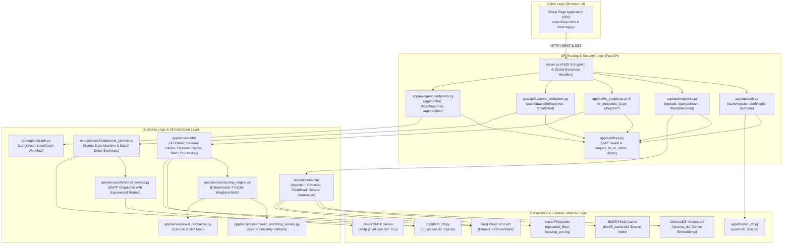
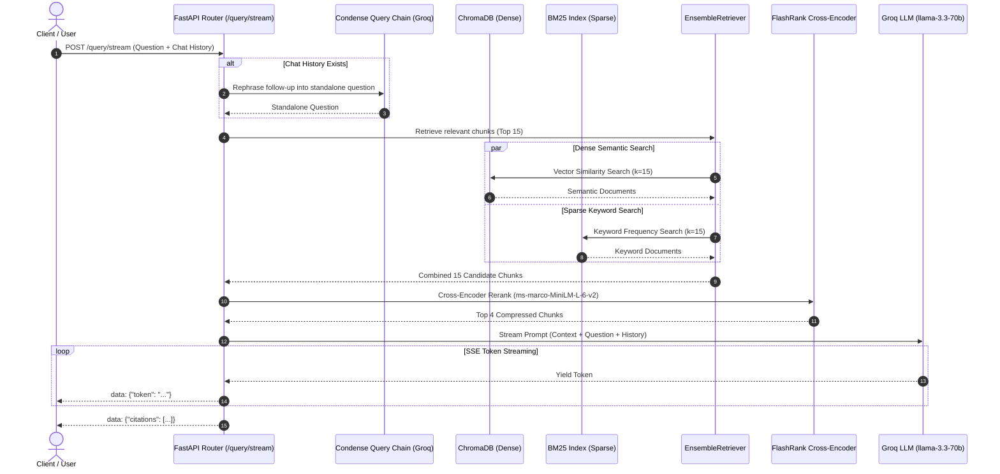
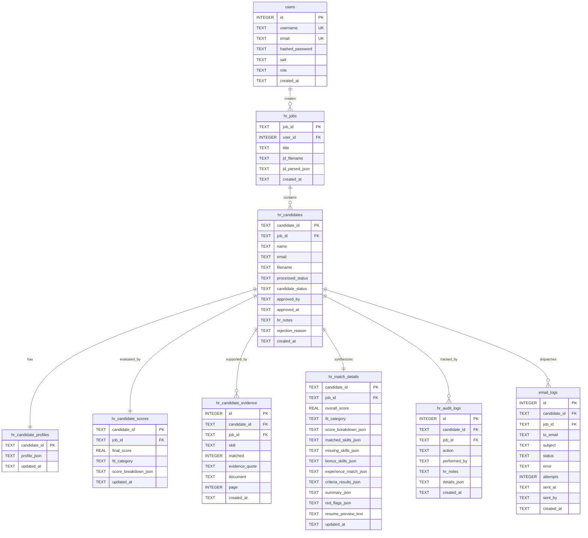
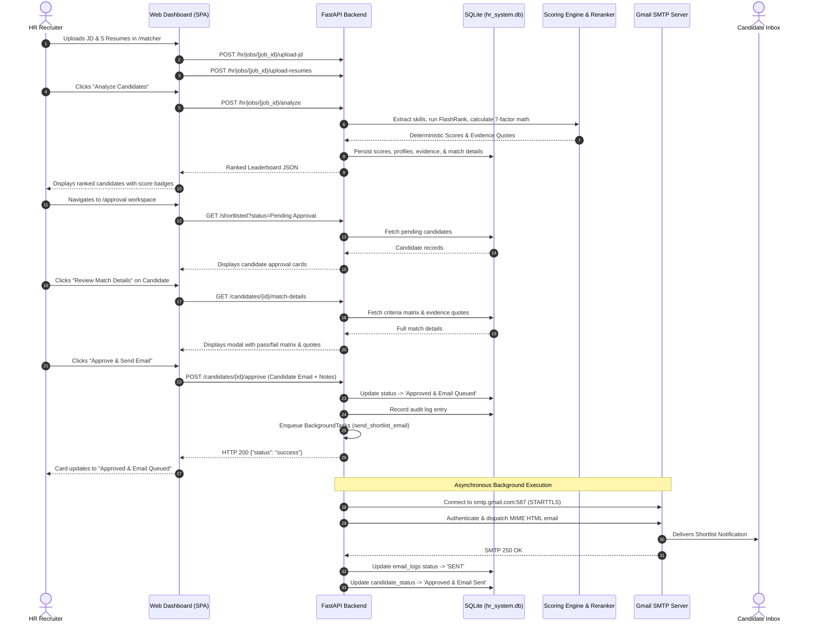
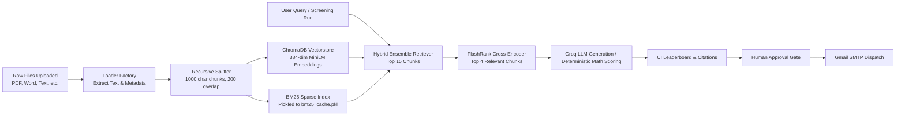
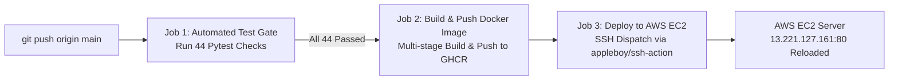
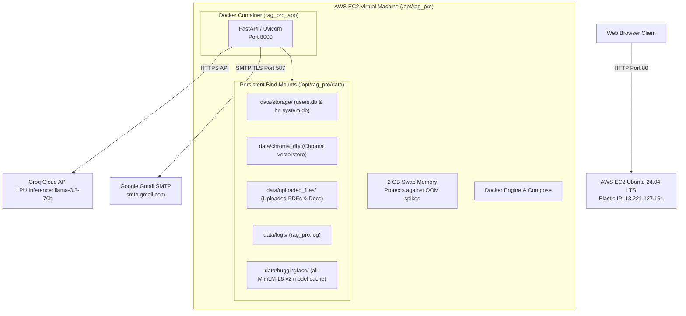

# 📘 RAGPro: Master Technical & Functional Documentation
**Enterprise Hybrid RAG Playbook Assistant & AI HR Candidate Matching Platform**

* **Document Version:** 2.0.0
* **System Release Status:** Production-Ready MVP
* **Target Environment:** AWS EC2 Cloud Virtual Machine (Ubuntu 24.04 LTS)
* **Live System URL:** [http://13.221.127.161](http://13.221.127.161)
* **Container Registry:** GitHub Container Registry (`ghcr.io/mekavenkatakishore/rag:latest`)
* **Repository CI/CD Pipeline:** GitHub Actions (`.github/workflows/deploy.yml`)
* **Last Verified Date:** November 2026

---

## 📑 Table of Contents

1. [Executive Summary](#1-executive-summary)
2. [Project Overview](#2-project-overview)
3. [Project Objectives](#3-project-objectives)
4. [Problem Statement & Impact](#4-problem-statement--impact)
5. [Key Features & Capabilities](#5-key-features--capabilities)
6. [Technology Stack](#6-technology-stack)
7. [System Architecture](#7-system-architecture)
8. [RAG Architecture](#8-rag-architecture)
9. [RAG & Ingestion Pipeline](#9-rag--ingestion-pipeline)
10. [Project Modules & Components](#10-project-modules--components)
11. [Frontend Architecture & UI Journey](#11-frontend-architecture--ui-journey)
12. [Backend Architecture & API Gateway](#12-backend-architecture--api-gateway)
13. [Database Architecture & Persistence](#13-database-architecture--persistence)
14. [Authentication, Authorization & Security](#14-authentication-authorization--security)
15. [Configuration & Environment Variables](#15-configuration--environment-variables)
16. [Repository & Folder Structure](#16-repository--folder-structure)
17. [Development Lifecycle & Stages](#17-development-lifecycle--stages)
18. [Current Project Progress & Maturity](#18-current-project-progress--maturity)
19. [Capabilities & Business Benefits](#19-capabilities--business-benefits)
20. [Enterprise Use Cases](#20-enterprise-use-cases)
21. [End-to-End User Journeys](#21-end-to-end-user-journeys)
22. [Exhaustive API Reference](#22-exhaustive-api-reference)
23. [Data Flow & Lifecycle](#23-data-flow--lifecycle)
24. [Error Handling & Resilience](#24-error-handling--resilience)
25. [Logging, Telemetry & Health Checks](#25-logging-telemetry--health-checks)
26. [Automated Testing Strategy](#26-automated-testing-strategy)
27. [Docker & Containerization](#27-docker--containerization)
28. [Continuous Integration & Continuous Deployment (CI/CD)](#28-continuous-integration--continuous-deployment-cicd)
29. [Infrastructure as Code (IaC) / Terraform](#29-infrastructure-as-code-iac--terraform)
30. [Cloud Deployment Architecture](#30-cloud-deployment-architecture)
31. [Local Development Setup Guide](#31-local-development-setup-guide)
32. [Production Deployment Playbook](#32-production-deployment-playbook)
33. [Performance Benchmarks & Optimizations](#33-performance-benchmarks--optimizations)
34. [Scalability Architecture](#34-scalability-architecture)
35. [System Limitations](#35-system-limitations)
36. [Risk Register & Mitigations](#36-risk-register--mitigations)
37. [Architectural Decision Records (ADR)](#37-architectural-decision-records-adr)
38. [Dependency Inventory](#38-dependency-inventory)
39. [Future Strategic Roadmap](#39-future-strategic-roadmap)
40. [Glossary of Terms](#40-glossary-of-terms)
41. [Frequently Asked Questions (FAQ)](#41-frequently-asked-questions-faq)
42. [Final Project Assessment](#42-final-project-assessment)
43. [Next Actionable Steps](#43-next-actionable-steps)
44. [Documentation Maintenance Guidelines](#44-documentation-maintenance-guidelines)
45. [Information Required / Unidentified Items](#45-information-required--unidentified-items)

---

# 1. Executive Summary

### Simple Language Explanation
**RAGPro** is an all-in-one enterprise artificial intelligence platform designed to do two critical jobs exceptionally well:
1. **Intelligent Playbook Assistant:** It acts as a reliable internal digital expert. Employees and managers can upload internal company guidelines, standard operating procedures (SOPs), policy handbooks, and documentation (PDFs, Word documents, text files, PowerPoint slides, spreadsheets, Markdown, and web pages). Anyone can ask questions and receive instant, accurate, conversational answers grounded strictly in company documents—complete with exact citations, source filenames, and page numbers.
2. **AI HR Candidate Matcher & Human-in-the-Loop Approval System:** It automates recruitment screening. Recruiters upload a Job Description (JD) and a stack of candidate resumes. RAGPro normalizes technical skills, parses candidate backgrounds, matches requirements using both keyword and embedding similarity, and computes a **100% deterministic score (0–100%)** without letting the AI make up numbers. Recruiters can review detailed score breakdowns, check exact quotes from resumes, chat with an AI assistant to compare candidates, and authorize shortlist emails dispatched directly to candidates via Gmail SMTP.

### Technical Summary
Technically, RAGPro is a full-stack, decoupled, multi-workspace web application written in Python 3.11/FastAPI and modern vanilla JavaScript. It implements:
* **Hybrid Two-Stage Retrieval:** Combining Dense Semantic Retrieval (`ChromaDB` with `sentence-transformers/all-MiniLM-L6-v2`) and Sparse Keyword Retrieval (`BM25Retriever` via Rank-BM25) with an `EnsembleRetriever` weighted ensemble.
* **Contextual Compression & Cross-Encoder Reranking:** Local execution of `FlashRank` (`ms-marco-MiniLM-L-6-v2`) to compress top-15 retrieved passages down to the top-4 most relevant chunks, minimizing context stuffing and eliminating LLM distractions.
* **Ultra-Fast Generation & Token Streaming:** Powered by Groq Cloud's LPU inference engine running `llama-3.3-70b-versatile` over Server-Sent Events (SSE).
* **Deterministic Math Scoring Engine:** Python-level mathematical weighting (Required Skills 35%, Experience 20%, Semantic Relevance 15%, Project Relevance 10%, Preferred Skills 10%, Education 5%, Domain Fit 5%), completely isolating the scoring arithmetic from generative LLM hallucination.
* **Agentic AI Layer:** Assembled with `LangGraph` and `LangChain`, utilizing a `StateGraph` with in-memory `MemorySaver` checkpointer, intent classification, and tool dispatch.
* **Full-Stack Security & Persistence:** PBKDF2-HMAC-SHA256 password hashing with salt, PyJWT bearer token authorization, dual SQLite databases (`users.db` and `hr_system.db`), and isolated multi-tenant job containers.
* **Current Status:** Fully operational, containerized via Docker and Docker Compose, continuously integrated and deployed via GitHub Actions to an AWS EC2 instance (`13.221.127.161:80`) with 44 automated tests passing.

---

# 2. Project Overview

RAGPro serves three core operational workspaces, managed through a unified Single Page Application (SPA):

```mermaid
graph TD
    A[RAGPro Web UI] --> B[Workspace 1: Knowledge Assistant]
    A --> C[Workspace 2: JD & Resume Matcher]
    A --> D[Workspace 3: Approval Review]
    
    B --> B1[Multi-Format Document Upload]
    B --> B2[Hybrid Dense/Sparse Indexing]
    B --> B3[Real-Time SSE Token Streaming Q&A]
    B --> B4[Document Lifecycle Management]
    
    C --> C1[Job Description Ingestion & Parsing]
    C --> C2[Batch Candidate Resume Parsing]
    C --> C3[Canonical Skill Normalization]
    C --> C4[Deterministic Weighted Scoring]
    C --> C5[Ranked Leaderboard & Raw Text Preview]
    C --> C6[Conversational HR Candidate Chat]
    
    D --> D1[Pending Candidate Approval Review]
    D --> D2[Explainable Match Breakdown]
    D --> D3[Audit Trail & Status Tracking]
    D --> D4[Automated SMTP Email Dispatch]
```



### Who Uses RAGPro?
1. **Talent Acquisition Specialists & HR Recruiters:** To upload role specifications, batch process incoming applicant resumes, inspect deterministic match percentages, and trigger outreach.
2. **Hiring Managers & Engineering Leads:** To inspect candidates' deep skill breakdowns, review exact quotes extracted from resumes, and compare candidate profiles side-by-side using conversational AI.
3. **Employees, Engineers & Operations Staff:** To query company playbooks, engineering guidelines, compliance requirements, and HR leave policies.
4. **DevOps & System Administrators:** To deploy, configure, monitor, and scale the containerized platform across cloud environments.

---

# 3. Project Objectives

| Category | Objective | Implementation Mechanism | Why It Is Important |
| :--- | :--- | :--- | :--- |
| **Primary** | Unified Knowledge & Recruitment Platform | Dual-engine FastAPI backend serving both Playbook RAG and HR Screening | Eliminates software fragmentation and lowers enterprise tooling costs. |
| **Business** | Accelerate Time-to-Hire | Automated batch parsing and deterministic ranking | Reduces manual resume screening time from hours to seconds per batch. |
| **Technical** | Modular Clean Architecture | Service facades, decoupled routers, Pydantic schemas, and database context managers | Ensures long-term maintainability, testability, and painless refactoring. |
| **User** | Transparent & Explainable AI | Exact page citations and quote snippets for every generated claim and candidate score | Builds trust with HR professionals and guarantees compliance with hiring fairness standards. |
| **AI/RAG** | Zero Hallucination Retrieval | Hybrid search (Chroma + BM25) + FlashRank Cross-Encoder + Grounded Prompt Templates | Prevents LLMs from inventing facts or fabricating answers not present in source documents. |
| **Data** | Multi-Format Document Ingestion | Extensible Loader Factory supporting `.pdf`, `.docx`, `.txt`, `.csv`, `.pptx`, `.html`, `.md` | Accommodates unstructured data in any standard corporate format without pre-conversion. |
| **Automation** | Reliable Email Delivery | Background worker with SMTP TLS, exponential backoff retries, and idempotency guard | Replaces manual candidate outreach with dependable, auditable communication. |
| **Performance** | Sub-Second Query & Boot Latency | Incremental indexing, BM25 pickle cache, Groq LPU inference, and FlashRank singleton | Enables real-time UI interactivity without sluggish model loading delays. |
| **Security** | Robust Authentication & RBAC | PBKDF2-HMAC-SHA256 (260,000 iterations), JWT tokens, and strict role guards | Secures sensitive company intellectual property and candidate personal data. |
| **Scalability** | Cloud-Native Portability | Docker containerization, CPU PyTorch optimization (~1.2 GB image), persistent bind mounts | Allows seamless migration from local developer laptops to AWS EC2 or Kubernetes clusters. |

---

# 4. Problem Statement & Impact

### Before RAGPro vs After RAGPro

| Dimension | Before RAGPro (Traditional / Manual Approach) | After RAGPro (Automated Hybrid Platform) |
| :--- | :--- | :--- |
| **Playbook Search** | Keyword-only search (Ctrl+F) that misses synonyms, conceptual queries, and related phrasing. | Hybrid Dense + Sparse search with Cross-Encoder reranking; understands semantics and acronyms. |
| **Document Q&A** | Employees spend hours reading multi-page PDFs to find specific corporate guidelines or leave policies. | Conversational AI delivers instant answers in seconds, citing exact document names and page numbers. |
| **Resume Screening** | Recruiters manually review hundreds of resumes; prone to cognitive fatigue, oversight, and bias. | Automated batch ingestion parses, extracts, and evaluates resumes in parallel within seconds. |
| **AI Scoring Reliability** | Pure LLM scoring hallucinates math (e.g. grading the same resume 65% then 90% on subsequent runs). | Deterministic 7-factor mathematical engine computes 100% reproducible, explainable scores in Python. |
| **Skill Variations** | Variations like "Postgres", "PostgreSQL", and "PG" fail keyword filters and get misclassified. | Canonical normalization dictionary + embedding cosine similarity fallback catches all tech variants. |
| **Recruitment Action** | Recruiters copy-paste candidate emails manually; high risk of duplicate or missed communications. | Integrated Human-in-the-Loop review with automated SMTP email delivery and audit logging. |
| **System Boot Time** | Heavy embedding re-indexing on every boot locks the application for minutes. | Incremental indexing with BM25 pickle caching restores server readiness in under 5 seconds. |

---

# 5. Key Features & Capabilities

### Feature Inventory Matrix

| Feature Name | Category | Purpose & Description | Input | Output | Status |
| :--- | :--- | :--- | :--- | :--- | :---: |
| **Multi-Format Ingestion** | Data Processing | Validates and parses 7 file formats (`.pdf`, `.docx`, `.txt`, `.csv`, `.pptx`, `.html`, `.md`) | Raw binary file upload | LangChain `Document` objects with metadata | **Completed** |
| **Incremental Indexing** | RAG Pipeline | Detects file modifications via mtime; only updates modified chunks | Upload directory files | Updated ChromaDB & `index_registry.json` | **Completed** |
| **BM25 Pickle Cache** | RAG Pipeline | Persists sparse token index to `bm25_cache.pkl` for fast server boot | Document chunk list | Serialized binary pickle cache | **Completed** |
| **Hybrid Retrieval** | RAG Pipeline | Combines semantic Chroma vector search and keyword BM25 retrieval | Query string | Weighted ensemble of candidate chunks (top 15) | **Completed** |
| **FlashRank Reranking** | RAG Pipeline | Cross-encoder contextual compression to compress context to top 4 | Top 15 candidate chunks | Top 4 highly relevant chunks | **Completed** |
| **Real-Time Token Streaming** | API / UI | Streams word-by-word LLM answers via Server-Sent Events (SSE) | Query request + chat history | `text/event-stream` chunk stream | **Completed** |
| **General Knowledge Fallback** | AI Generation | Explicitly labels when an answer falls outside indexed document context | User query with missing context | Truthful answer labeled "Based on general knowledge" | **Completed** |
| **Document Lifecycle** | Management | Safely deletes documents from disk, ChromaDB, and index registry | Target filename | Cleaned disk and vectorstore | **Completed** |
| **JD Requirement Parsing** | HR Screening | Extracts role title, required/preferred skills, experience, education | JD document (PDF/Word/Text) | Structured JSON requirements schema | **Completed** |
| **Batch Resume Parsing** | HR Screening | Ingests multiple candidate resumes concurrently for a specific job container | Batch resume files | Indexed candidate documents with metadata | **Completed** |
| **Canonical Skill Normalization**| HR Screening | Maps 90+ technology variations (e.g. "K8s" -> "Kubernetes") | Raw skill strings | Canonical technology names | **Completed** |
| **Deterministic Scoring Engine**| HR Screening | Computes 100% reproducible math scores across 7 weighted criteria | Extracted facts + JD criteria | 0–100% score + fit classification | **Completed** |
| **Semantic Matching Fallback** | HR Screening | Uses embedding cosine similarity (threshold 0.40) for unmapped synonyms | Unmatched skill phrases | Matched skill confirmation | **Completed** |
| **Candidate Leaderboard** | UI / HR | Displays interactive, ranked candidate table with score badges | `job_id` | Ranked candidate list with fit status | **Completed** |
| **Citation Evidence Verification**| UI / HR | Displays exact resume quote snippets with document name and page | `candidate_id` | List of quotes and page numbers | **Completed** |
| **Live Resume Preview** | UI / HR | Extracts and displays raw text of candidate resume in modal | `candidate_id` | Formatted plain text preview | **Completed** |
| **Human-in-the-Loop Approval** | Workflow | Allows HR to review match metrics, approve, hold, or reject candidate | Action button + optional notes | Status change + audit log record | **Completed** |
| **Automated SMTP Emailer** | Automation | Dispatches professional HTML/plain-text emails with retry & backoff | Approved candidate trigger | SMTP delivery + `email_logs` entry | **Completed** |
| **Email Idempotency Guard** | Automation | Prevents duplicate email dispatches on repeated clicks or approvals | Candidate status check | Blocks duplicate dispatch | **Completed** |
| **Conversational HR Chat** | Agentic AI | Allows HR recruiters to ask comparative questions about candidates | Prompt + `job_id` | Conversational LLM comparative synthesis | **Completed** |
| **Agentic StateGraph (LangGraph)**| Agentic AI | Multi-node agent with MemorySaver checkpointer and tool routing | Prompt + thread ID | Multi-step agent execution + activity logs | **Completed** |
| **PBKDF2 & JWT Security** | Security | Secure password hashing (260k iterations) and signed token authorization | User credentials | JWT bearer access token | **Completed** |
| **RBAC Route Protection** | Security | Enforces role checks (`hr`, `admin`, `recruiter`) on approval routes | User JWT role claim | Authorized request or HTTP 403 | **Completed** |
| **Global Error Envelope** | API Gateway | Normalizes all 4xx/5xx errors into uniform JSON envelope | Any error condition | `{"status": "error", "message": "..."}` | **Completed** |
| **Candidate Export (CSV/JSON)** | Reporting | Exports job candidate leaderboard and metrics to CSV or JSON | `job_id` + export format | Downloadable file export | **Completed** (in `hr_endpoints_v2.py`) |
| **Persistent Model Volume** | DevOps | Persists Hugging Face model cache via `HF_HOME=/app/data/huggingface` | Container boot | Zero re-download startup | **Completed** |
| **EC2 Auto-Deploy CI/CD** | DevOps | GitHub Actions builds GHCR image and executes SSH container reload | `git push origin main` | Live updated container on EC2 | **Completed** |

---

# 6. Technology Stack

### Categorized Technology Inventory

| Category | Technology | Version / Model | Where Used | Why Used | Current Status |
| :--- | :--- | :--- | :--- | :--- | :---: |
| **Frontend** | HTML5 / CSS3 / Vanilla JS | ES6+ | `static/index.html`, `static/style.css`, `static/app.js` | Zero build step required; lightweight, ultrafast rendering, no npm dependencies | **Active / Production** |
| **Frontend UI Icons** | Lucide Icons | Latest (CDN) | `static/index.html`, `static/app.js` | Modern, consistent, scalable SVG iconography across dark-mode interface | **Active / Production** |
| **Frontend Typography** | Google Fonts | Plus Jakarta Sans, Outfit, DM Sans | `static/index.html` | Clean, modern corporate dashboard aesthetics | **Active / Production** |
| **Backend Framework** | FastAPI | `>=0.110.0` | `server.py`, `app/api/*` | Asynchronous ASGI performance, automatic OpenAPI documentation, native Pydantic support | **Active / Production** |
| **ASGI Web Server** | Uvicorn | Standard | `server.py`, `Dockerfile` | High-throughput asynchronous HTTP/1.1 and WebSocket server implementation | **Active / Production** |
| **Programming Language** | Python | 3.11 (Prod) / 3.14 (Dev) | Entire backend codebase | Industry-standard language for AI, data manipulation, and web APIs | **Active / Production** |
| **LLM Provider** | Groq Cloud | API Cloud | `app/core/llm_factory.py` | Ultra-low latency LPU inference engine enabling instant conversational streaming | **Active / Production** |
| **Generative LLM Model** | Llama 3.3 Versatile | `llama-3.3-70b-versatile` | `app/core/llm_factory.py`, RAG & Agent | 70-billion parameter reasoning power with strict adherence to prompt context | **Active / Production** |
| **Dense Embedding Model** | Hugging Face / PyTorch | `sentence-transformers/all-MiniLM-L6-v2` | `app/services/rag/ingestion_service.py` | Fast, lightweight (384-dimensional) CPU-optimized semantic document representation | **Active / Production** |
| **Cross-Encoder Reranker**| FlashRank | `ms-marco-MiniLM-L-6-v2` | `app/services/rag/reranking_service.py` | Highly efficient local cross-encoder reranking without external API calls or GPU needs | **Active / Production** |
| **Sparse Retriever** | Rank-BM25 | `rank_bm25` | `app/services/rag/retrieval_service.py` | Exact token/keyword frequency search balancing dense semantic retrieval | **Active / Production** |
| **Vector Database** | ChromaDB | `chromadb==1.0.20`, `langchain-chroma` | `chroma_db/` | Embedded vector database with native metadata filtering and zero server overhead | **Active / Production** |
| **Relational Database** | SQLite 3 | Built-in Python standard library | `app/db/users.db`, `app/db/hr_system.db` | Zero-configuration ACID compliance, file-based portability, robust relational querying | **Active / Production** |
| **Agentic Framework** | LangGraph | `>=0.2.0` | `app/agent/graph.py` | Multi-actor cyclical graph state management, conditional routing, and checkpointing | **Active / Production** |
| **AI Orchestration** | LangChain / LangChain Core | Standard (`langchain`, `langchain-classic`) | Throughout backend services | Standardized document loaders, prompt templates, tool wrappers, and runnable chains | **Active / Production** |
| **Document Parsers** | PyPDF, Docx2txt, BS4, python-pptx | Standard requirements | `app/loaders/*` | Native text extraction across PDF, Word, HTML, PowerPoint, CSV, and Markdown | **Active / Production** |
| **Security & Auth** | PyJWT | `>=2.8.0` | `app/core/security.py`, `app/api/deps.py` | Compact, self-contained JSON Web Token authentication with HMAC SHA-256 signatures | **Active / Production** |
| **Password Hashing** | hashlib (PBKDF2-HMAC) | Python built-in standard library | `app/core/security.py` | Cryptographically secure password hashing (260,000 iterations + 32-byte salt) | **Active / Production** |
| **Email Protocol** | smtplib / email.mime | Python built-in standard library | `app/services/hr/email_service.py` | Standard SMTP with TLS/SSL encryption for real-world candidate outreach | **Active / Production** |
| **Containerization** | Docker & Docker Compose | Docker Engine 24+, Compose v2 | `Dockerfile`, `docker-compose.yml` | Multi-stage, reproducible, isolated deployment environment | **Active / Production** |
| **Continuous Integration**| GitHub Actions | v4/v5 Actions | `.github/workflows/deploy.yml` | Automated testing gate, Docker image building, and container registry publishing | **Active / Production** |
| **Container Registry** | GitHub Container Registry (GHCR)| `ghcr.io/mekavenkatakishore/rag` | `.github/workflows/deploy.yml` | Secure, integrated cloud Docker image storage | **Active / Production** |
| **Cloud Hosting Host** | AWS EC2 | Ubuntu 24.04 LTS (t3.medium/t2.micro) | Target host (`13.221.127.161`) | Resilient, globally accessible Linux cloud compute virtual machine | **Active / Production** |
| **Automated Testing** | Pytest | `pytest-9.1.1`, `httpx` | `tests/` (44 test cases) | Fast, automated verification of smoke, security, database, RAG, and HR logic | **Active / Production** |
| **Logging** | Python logging module | RotatingFileHandler (10MB x 5) | `app/utils/logger.py`, `logs/rag_pro.log` | Structured console and disk file logging for auditing and debugging | **Active / Production** |
| **IaC / Terraform** | *None* | N/A | N/A | **Not identified in the current project/codebase.** | Not Present |
| **Kubernetes (K8s)** | *None* | N/A | N/A | **Not identified in the current project/codebase.** | Not Present |
| **Redis / Memcached** | *None* | N/A | N/A | **Not identified in the current project/codebase.** | Not Present |
| **External APM / Sentry**| *None* | N/A | N/A | **Not identified in the current project/codebase.** | Not Present |

---

# 7. System Architecture

RAGPro implements a **Clean Layered Architecture**, strictly separating presentation, API routing, business services, database access, and core infrastructure:



---

# 8. RAG Architecture

The Retrieval-Augmented Generation engine uses a **Hybrid Two-Stage Pipeline**:



---

# 9. RAG Pipeline

### 9.1 Data Ingestion
* **Supported Formats:** `.pdf`, `.docx`, `.txt`, `.csv`, `.pptx`, `.html`, `.htm`, `.md`.
* **Loader Dispatch:** Controlled by `app/loaders/loader_factory.py`. Validates file existence and non-zero byte size before dispatching to specialized loaders (`pypdf.PyPDFLoader`, `docx2txt.Docx2txtLoader`, `langchain_community.document_loaders.TextLoader`, `CSVLoader`, `UnstructuredPowerPointLoader`, `BSHTMLLoader`, `UnstructuredMarkdownLoader`).
* **Metadata Attachment:** Every ingested chunk receives `filename`, `extension`, `upload_timestamp`, and original filesystem `source`.

### 9.2 Chunking Strategy
* **Primary Strategy (Default):** `RecursiveCharacterTextSplitter` configured with `CHUNK_SIZE = 1000` characters and `CHUNK_OVERLAP = 200` characters. This ensures semantic continuity across chunk boundaries.
* **Secondary Strategy (Configurable):** `SemanticChunker` (`langchain_experimental`), splitting based on semantic distance percentiles (default 90.0 percentile threshold) using the embedding model.

### 9.3 Embeddings & Vector Database
* **Embedding Model:** `sentence-transformers/all-MiniLM-L6-v2`, running locally on CPU via HuggingFaceEmbeddings. Produces 384-dimensional dense vector embeddings.
* **Vector Database:** `ChromaDB`, persisted locally to disk at `chroma_db/` (or mapped container volume `/app/chroma_db`).
* **Sparse Index:** `BM25Retriever` built over all ingested document chunks and cached to `chroma_db/bm25_cache.pkl`.
* **Change Detection:** `chroma_db/index_registry.json` tracks file modification timestamps (`mtime`). Unchanged files skip re-indexing, yielding boot times under 5 seconds.

### 9.4 Retrieval & Reranking
* **Stage 1 (Hybrid Ensemble):** `EnsembleRetriever` queries both ChromaDB and BM25 with configurable weights (`HYBRID_SEMANTIC_WEIGHT = 0.5`, `HYBRID_KEYWORD_WEIGHT = 0.5`) to collect the top `RETRIEVER_TOP_K = 15` candidate passages.
* **Stage 2 (Cross-Encoder Reranking):** `FlashrankRerank` with `ms-marco-MiniLM-L-6-v2` re-evaluates all 15 passages against the user query, outputting the top `RERANKER_TOP_N = 4` passages.

### 9.5 Prompt Construction & LLM Generation
* **Condense Query Prompt:** If conversation history is present, rephrases follow-up queries into standalone questions.
* **Playbook QA Prompt:** Injects the 4 reranked context passages, chat history, and question into `llama-3.3-70b-versatile` with temperature `0.3`.
* **Truthfulness Guard:** Explicitly instructs the model:
  > *"If the Context does NOT contain information relevant to the question, say plainly that it wasn't found in the uploaded documents... then answer using general knowledge, clearly labeled as 'Based on general knowledge'."*
* **Response Delivery:** Transmitted word-by-word via Server-Sent Events (SSE) through `POST /query/stream`.

---

# 10. Project Modules

### Complete Module Inventory

| Module Path | Primary Responsibilities | Dependencies | Status |
| :--- | :--- | :--- | :---: |
| `server.py` | ASGI server entry point, CORS, exception handlers, static file serving, startup events | FastAPI, Uvicorn, Starlette | **Complete** |
| `app/core/config.py` | Centralized Pydantic settings loading from `.env` | `pydantic`, `python-dotenv` | **Complete** |
| `app/core/security.py` | PBKDF2 password hashing, salt generation, JWT encoding and decoding | `hashlib`, `hmac`, `secrets`, `pyjwt` | **Complete** |
| `app/core/llm_factory.py` | Groq LLM client factory with automatic active model discovery and fallbacks | `langchain-groq`, `requests` | **Complete** |
| `app/core/exceptions.py` | Domain exception hierarchy (`RAGProException`, `AuthenticationError`, etc.) | None | **Complete** |
| `app/db/base_db.py` | SQLite context manager for connection pooling, commit, and rollback safety | `sqlite3` | **Complete** |
| `app/db/user_db.py` | User account persistence, default admin seeding, user lookups | `app/db/base_db.py`, `app/core/config.py` | **Complete** |
| `app/db/hr_db.py` | Storage of jobs, candidates, profiles, scores, evidence, match details, audit logs, email logs | `app/db/base_db.py`, `app/core/config.py` | **Complete** |
| `app/loaders/` | Factory dispatch for multi-format document loading (.pdf, .docx, .txt, .csv, .ppt, .html, .md) | `pypdf`, `docx2txt`, `bs4`, `python-pptx` | **Complete** |
| `app/services/rag/` | Ingestion, chunking, hybrid retrieval, FlashRank reranking, and generation chains | `langchain`, `chromadb`, `flashrank` | **Complete** |
| `app/services/hr/` | JD parsing, resume extraction, evidence caching, batch processing, email dispatch | `app/db/hr_db.py`, `app/core/llm_factory.py`| **Complete** |
| `app/services/scoring_engine.py` | Deterministic 7-factor candidate qualification math (0–100%) | `app/services/skill_normalizer.py` | **Complete** |
| `app/services/semantic_matching_service.py`| Cosine similarity fallback for tech synonyms (threshold 0.40) and whole JD relevance | `numpy`, `sentence-transformers` | **Complete** |
| `app/services/skill_normalizer.py` | Canonical mapping for 90+ technology names | Python standard `re` | **Complete** |
| `app/agent/` | LangGraph StateGraph workflow, MemorySaver checkpointer, intent classifier, tool execution | `langgraph`, `langchain` | **Complete** |
| `app/api/endpoints.py` | Playbook RAG routes: upload, status, streaming query, file delete | `app/services/rag/` | **Complete** |
| `app/api/auth.py` | User registration, login, and `/auth/me` endpoints | `app/services/auth/` | **Complete** |
| `app/api/hr_endpoints.py` | Job container screening, JD upload, resume upload, analysis, leaderboard | `app/services/hr/`, `app/db/hr_db.py` | **Complete** |
| `app/api/approval_endpoints.py`| Shortlist review, match details, approve, reject, hold, email preview, retry email | `app/services/hr/approval_service.py` | **Complete** |
| `app/api/agent_endpoints.py`| Agentic chat, human approval resume/reject, thread state status | `app/agent/graph.py` | **Complete** |
| `static/` | Dark-mode SPA UI: `index.html`, `style.css`, `app.js` | Lucide Icons, Google Fonts | **Complete** |
| `tests/` | 44 automated test cases covering smoke, security, database, RAG, and HR logic | `pytest`, `httpx` | **Complete** |

---

# 11. Frontend Architecture & UI Journey

### Single Page Application (SPA) Structure
The frontend is implemented entirely in vanilla ES6+ JavaScript, HTML5, and CSS3. It does not require Node.js, Webpack, or npm builds, allowing the server to serve it directly from `static/`.

### Client-Side Routes & Views
* **Route `/home` (`#home`):** Workspace Chooser displaying three interactive cards:
  1. *Knowledge Assistant* (`/chat`)
  2. *JD & Resume Matcher* (`/matcher`)
  3. *Approval Review* (`/approval`)
* **Route `/chat` (`#chat`):** Playbook Assistant interface with file drag-and-drop upload, indexed document list with delete buttons, real-time streaming chat messages, and citation accordions.
* **Route `/matcher` (`#matcher`):** HR Candidate Matcher interface with JD upload, batch resume ingestion, ranked leaderboard table, fit category filters, raw resume text preview, and candidate details modal.
* **Route `/approval` (`#approval`):** Human-in-the-Loop Approval dashboard displaying shortlisted candidates pending authorization, match criteria matrices, email previews, approval/rejection action buttons, and audit trail logs.

### User Journey
1. **Authentication:** The user arrives at `http://13.221.127.161`. If unauthenticated, the modal prompts for login or registration (with an auto-fill button for `admin` / `admin@2026`).
2. **Workspace Selection:** The user lands on `/home` and selects their desired workspace.
3. **Document Ingestion:** In `/chat`, the user drops a company playbook. Progress bars track upload and indexing.
4. **Conversational Query:** The user enters a question. The UI opens an SSE connection, streaming tokens in real time.
5. **HR Candidate Screening:** In `/matcher`, the recruiter uploads a Job Description and 10 resumes, clicks "Analyze", and inspects the ranked leaderboard within 3 seconds.
6. **Authorization & Outreach:** In `/approval`, the recruiter inspects Candidate Match Details, validates extracted skills, and clicks "Approve & Send". The backend enqueues Gmail SMTP dispatch, records an audit log, and updates the candidate's status.

---

# 12. Backend Architecture & API Gateway

FastAPI serves as the core ASGI framework, configured in `server.py`.

### Unified Error Handling Envelope
Every error funnels through global exception handlers in `server.py`, ensuring consistent JSON responses across all status codes:
```json
{
  "status": "error",
  "message": "Human-readable explanation of error.",
  "detail": "Detailed validation or technical trace (if applicable)"
}
```

### Complete API Endpoint Inventory

| Method | Endpoint | Purpose | Request Body | Response Shape | Auth Required |
| :--- | :--- | :--- | :--- | :--- | :---: |
| `GET` | `/` | Redirects client directly to web UI | None | HTTP 307 Redirect to `/static/index.html` | No |
| `GET` | `/status` | Returns system indexing status & file list | None | `{"uploaded_files": [...], "total_chunks": 42}` | No |
| `POST`| `/auth/register` | Registers a new user account | `{"username", "email", "password"}` | `{"status": "success", "user_id": 1}` | No |
| `POST`| `/auth/login` | Authenticates user & issues JWT token | `{"username", "password"}` | `{"access_token": "...", "token_type": "bearer"}` | No |
| `GET` | `/auth/me` | Returns current user profile | None | `{"id": 1, "username": "admin", "role": "hr"}` | Bearer Token |
| `POST`| `/upload` | Uploads and indexes playbook document | `multipart/form-data` (`file`) | `{"status": "success", "total_chunks": 12}` | Bearer Token |
| `POST`| `/query` | Submits non-streaming RAG query | `{"prompt": "...", "chat_history": []}` | `{"answer": "...", "citations": [...]}` | Bearer Token |
| `POST`| `/query/stream` | Submits RAG query with SSE streaming | `{"prompt": "...", "chat_history": []}` | `text/event-stream` token stream | Bearer Token |
| `DELETE`| `/files/{filename}` | Deletes document from disk & vectorstore | Path variable (`filename`) | `{"status": "success", "total_chunks": 0}` | Bearer Token |
| `POST`| `/hr/jobs` | Creates a new candidate screening job | `{"title": "Role Title"}` | `{"status": "success", "job": {...}}` | Bearer Token |
| `POST`| `/hr/jobs/{job_id}/upload-jd` | Uploads & parses Job Description | `multipart/form-data` (`file`) | `{"status": "success", "jd_parsed": {...}}` | Bearer Token |
| `POST`| `/hr/jobs/{job_id}/upload-resumes`| Batch uploads candidate resumes | `multipart/form-data` (`files`) | `{"status": "success", "total_files": 5}` | Bearer Token |
| `POST`| `/hr/jobs/{job_id}/analyze` | Triggers deterministic scoring math | Path variable (`job_id`) | `{"status": "success", "leaderboard": [...]}` | Bearer Token |
| `GET` | `/hr/jobs/{job_id}/leaderboard` | Fetches ranked candidate leaderboard | Path variable (`job_id`) | `{"status": "success", "candidates": [...]}` | Bearer Token |
| `GET` | `/hr/jobs/{job_id}/candidates/{id}`| Fetches candidate score & evidence | Path variable (`id`) | `{"score": 92.5, "fit": "Strong Fit", ...}` | Bearer Token |
| `GET` | `/hr/jobs/{job_id}/candidates/{id}/resume-preview`| Raw text resume preview | Path variable (`id`) | `{"resume_text": "..."}` | Bearer Token |
| `POST`| `/hr/jobs/{job_id}/chat` | Conversational Q&A about candidates | `{"prompt": "Who has Python?"}` | `{"response": "..."}` | Bearer Token |
| `POST`| `/hr/jobs/{job_id}/clear` | Purges candidate files and database rows| Path variable (`job_id`) | `{"status": "success"}` | Bearer Token |
| `GET` | `/shortlisted` | Lists candidates for approval review | Query params (`status`, `sort_by`) | `{"total": 5, "candidates": [...]}` | HR/Admin RBAC |
| `GET` | `/candidates/{id}/match-details` | Full criteria pass/fail matrix | Path variable (`id`) | `{"overall_score": 88.0, "criteria": [...]}` | HR/Admin RBAC |
| `POST`| `/candidates/{id}/approve` | Approves candidate & triggers email | JSON / Query: `candidate_email`, `hr_notes` | `{"candidate_status": "Approved & Email Queued"}` | HR/Admin RBAC |
| `POST`| `/candidates/{id}/reject` | Rejects candidate with reason | `{"rejection_reason", "hr_notes"}` | `{"candidate_status": "Rejected"}` | HR/Admin RBAC |
| `POST`| `/candidates/{id}/hold` | Places candidate on hold | `{"hr_notes"}` | `{"candidate_status": "On Hold"}` | HR/Admin RBAC |
| `PUT` | `/candidates/{id}/email` | Updates candidate email address | `{"email": "valid@email.com"}` | `{"status": "success", "email": "..."}` | HR/Admin RBAC |
| `GET` | `/candidates/{id}/email-preview`| Renders HTML/plain-text email preview | Path variable (`id`) | `{"subject": "...", "html": "..."}` | HR/Admin RBAC |
| `POST`| `/candidates/{id}/retry-email` | Re-queues failed shortlist email | Path variable (`id`) | `{"status": "success", "email_status": "queued"}` | HR/Admin RBAC |
| `GET` | `/candidates/{id}/audit-logs` | Fetches candidate audit trail | Path variable (`id`) | `{"logs": [...]}` | HR/Admin RBAC |
| `POST`| `/agent/chat` | Invokes LangGraph Agentic workflow | `{"prompt": "...", "thread_id": "..."}` | `{"intent": "...", "response": "..."}` | Bearer Token |
| `POST`| `/agent/approve` | Resumes paused agent action | `{"thread_id": "..."}` | `{"approval_status": "approved"}` | Bearer Token |
| `POST`| `/agent/reject` | Cancels paused agent action | `{"thread_id": "..."}` | `{"approval_status": "rejected"}` | Bearer Token |
| `GET` | `/agent/status/{thread_id}` | Checks thread state snapshot | Path variable (`thread_id`) | `{"activity_logs": [...]}` | Bearer Token |

---

# 13. Database Architecture & Persistence

RAGPro utilizes two SQLite relational databases managed through a connection pooling context manager (`app/db/base_db.py`).

### Entity Relationship Diagram



---

# 14. Authentication, Authorization & Security

### Cryptographic Security Primitives
* **Password Hashing:** Implemented via `hashlib.pbkdf2_hmac("sha256", password, salt, 260_000)`. Every user is provisioned a unique 32-byte (64-character hex) random salt (`secrets.token_hex(32)`) preventing rainbow table attacks.
* **Verification:** Uses constant-time `hmac.compare_digest` to prevent timing attacks.
* **JWT Access Tokens:** Signed using HMAC SHA-256 (`HS256`) with `JWT_SECRET_KEY` and 24-hour expiration (`JWT_TOKEN_EXPIRE_HOURS = 24`).

### Role-Based Access Control (RBAC)
* Route dependency `require_hr_or_admin` in `app/api/deps.py` enforces role permissions. Only accounts with role `hr`, `admin`, or `recruiter` can perform approval, rejection, hold, or email dispatch actions. Non-HR accounts receive HTTP 403 Forbidden.

### Security Audit Findings & Gaps
1. **CORS Configuration:** `server.py` currently configures `allow_origins=["*"]`. In production, this should be restricted to the explicit domain name or IP of the host.
2. **Database Encryption:** SQLite databases are stored in plain text on the host disk. Disk-level encryption (e.g. AWS EBS Encryption) must be enabled on production volumes.
3. **API Rate Limiting:** No per-IP or per-user rate limiting middleware (such as `slowapi` or Redis-backed token buckets) is currently enforced on `/auth/login` or `/query`.

---

# 15. Configuration & Environment Variables

All settings load from `.env` via `app/core/config.py`.

| Variable | Purpose | Required? | Example Format | Used By |
| :--- | :--- | :---: | :--- | :--- |
| `GROQ_API_KEY` | Authentication with Groq Cloud LPU API | **Yes** | `gsk_YOUR_API_KEY` | `app/core/llm_factory.py` |
| `GROQ_MODEL` | Target generative LLM model identifier | No | `llama-3.3-70b-versatile` | `app/core/llm_factory.py` |
| `JWT_SECRET_KEY` | Secret key used to sign and verify JWTs | **Yes** | `YOUR_SECRET_KEY` | `app/core/security.py` |
| `JWT_ALGORITHM` | Hashing algorithm for JWT signatures | No | `HS256` | `app/core/security.py` |
| `JWT_TOKEN_EXPIRE_HOURS` | Lifetime of issued JWT access tokens | No | `24` | `app/core/security.py` |
| `EMBEDDING_MODEL` | Hugging Face dense embedding model name | No | `sentence-transformers/all-MiniLM-L6-v2` | `app/services/rag/ingestion_service.py` |
| `RERANKER_MODEL` | FlashRank cross-encoder model name | No | `ms-marco-MiniLM-L-6-v2` | `app/services/rag/reranking_service.py` |
| `CHUNKING_STRATEGY`| Text chunking method (`recursive`/`semantic`)| No | `recursive` | `app/services/rag/ingestion_service.py` |
| `CHUNK_SIZE` | Target character count per document chunk | No | `1000` | `app/services/rag/ingestion_service.py` |
| `CHUNK_OVERLAP` | Character overlap between consecutive chunks | No | `200` | `app/services/rag/ingestion_service.py` |
| `RETRIEVER_TOP_K` | Number of candidate chunks from hybrid search | No | `15` | `app/services/rag/retrieval_service.py` |
| `RERANKER_TOP_N` | Number of chunks after FlashRank reranking | No | `4` | `app/services/rag/reranking_service.py` |
| `HYBRID_SEMANTIC_WEIGHT`| Weight allocated to dense Chroma vector search | No | `0.5` | `app/services/rag/retrieval_service.py` |
| `HYBRID_KEYWORD_WEIGHT` | Weight allocated to sparse BM25 search | No | `0.5` | `app/services/rag/retrieval_service.py` |
| `SMTP_HOST` | Outgoing SMTP mail server hostname | No | `smtp.gmail.com` | `app/services/hr/email_service.py` |
| `SMTP_PORT` | Outgoing SMTP port (587 for TLS) | No | `587` | `app/services/hr/email_service.py` |
| `SMTP_USER` | Recruiter Gmail / SMTP username | No | `recruiter@example.com` | `app/services/hr/email_service.py` |
| `SMTP_PASSWORD` | Google App Password (16 characters) | No | `YOUR_APP_PASSWORD` | `app/services/hr/email_service.py` |
| `SMTP_FROM_NAME` | Sender display name on outreach emails | No | `Talent Acquisition Team` | `app/services/hr/email_service.py` |
| `SMTP_FROM_EMAIL` | Sender address appearing in candidate inbox | No | `recruiter@example.com` | `app/services/hr/email_service.py` |
| `SMTP_USE_TLS` | Enables STARTTLS encryption | No | `true` | `app/services/hr/email_service.py` |
| `SMTP_USE_SSL` | Enables direct SSL encryption | No | `false` | `app/services/hr/email_service.py` |
| `USER_DATABASE_PATH` | Path to user SQLite database | No | `/app/data/users.db` | `app/db/user_db.py` |
| `HR_DATABASE_PATH` | Path to HR system SQLite database | No | `/app/data/hr_system.db` | `app/db/hr_db.py` |
| `HF_HOME` | Directory to cache Hugging Face model files | No | `/app/data/huggingface` | Hugging Face Hub |

---

# 16. Repository & Folder Structure

```text
rag_pro/
├── .github/
│   └── workflows/
│       └── deploy.yml              # GitHub Actions CI/CD test, build, push, & deploy pipeline
├── app/
│   ├── agent/                      # 🤖 Agentic AI Layer (LangGraph StateGraph & Checkpointer)
│   │   ├── nodes/                  # Graph Workflow Nodes (Analysis, Execution, Response)
│   │   ├── tools/                  # LangChain @tool wrappers (RAG, HR matching, Email actions)
│   │   ├── graph.py                # StateGraph assembly with MemorySaver checkpointer
│   │   ├── prompts.py              # Intent classification prompt template
│   │   ├── router.py               # Conditional edge routing & human approval gate
│   │   └── state.py                # AgentState TypedDict definition
│   ├── api/                        # 🌐 API Routing Layer (FastAPI Controllers)
│   │   ├── agent_endpoints.py      # /agent/chat, /agent/approve, /agent/reject
│   │   ├── approval_endpoints.py   # Human-in-the-loop candidate approval & email endpoints
│   │   ├── auth.py                 # /auth/register, /auth/login, /auth/me
│   │   ├── deps.py                 # JWT Bearer token & RBAC permission dependencies
│   │   ├── endpoints.py            # Playbook RAG routes (/upload, /query/stream, /files)
│   │   ├── hr_endpoints.py         # Job-isolated candidate screening & analysis routes
│   │   └── hr_endpoints_v2.py      # Batch async HR endpoints & reporting features
│   ├── core/                       # ⚙️ Infrastructure & Application Configuration
│   │   ├── config.py               # Centralized Pydantic Settings wrapper for .env
│   │   ├── exceptions.py           # Domain exception classes (RAGProException hierarchy)
│   │   ├── llm_factory.py          # Groq ChatGroq client factory with auto-model discovery
│   │   └── security.py             # PBKDF2 hashing, salt generation, PyJWT token encoding
│   ├── db/                         # 💾 Data Persistence Layer (SQLite & Connection Pool)
│   │   ├── base_db.py              # Connection context manager for transactional safety
│   │   ├── hr_db.py                # Schema & queries for jobs, candidates, scores, logs
│   │   └── user_db.py              # Schema & queries for user accounts & admin seeding
│   ├── loaders/                    # 📄 Document Loader Factory & Format Extractors
│   │   ├── base.py                 # Base abstract document loader interface
│   │   ├── loader_factory.py       # Extension-based loader router
│   │   └── [pdf/docx/txt/csv/ppt/html/md]_loader.py # Dedicated file format extractors
│   ├── schemas/                    # 📋 Data Validation Schemas (Pydantic v2 Models)
│   │   ├── agent_schemas.py        # Agent chat, approve, reject request/response schemas
│   │   ├── approval_schemas.py     # Shortlist review, match details, email update schemas
│   │   ├── auth_schemas.py         # User registration and login schemas
│   │   ├── hr_schemas.py           # Job container, candidate, and chat schemas
│   │   └── rag_schemas.py          # Query, status, and citation schemas
│   ├── services/                   # 🧠 Core Business Logic & Orchestration Services
│   │   ├── auth/                   # Authentication service implementation
│   │   ├── hr/                     # Modular HR services (parsers, cache, batch, chat, email)
│   │   ├── rag/                    # Modular RAG services (ingestion, retrieval, reranking)
│   │   ├── hr_service.py           # Backward-compatible facade wrapper for HR package
│   │   ├── rag_service.py          # Backward-compatible facade wrapper for RAG package
│   │   ├── scoring_engine.py       # Deterministic 7-factor weighted scoring calculator
│   │   ├── semantic_matching_service.py # Embedding cosine similarity fallback for skills
│   │   └── skill_normalizer.py     # Canonical technology and skill mapper (90+ entries)
│   └── utils/
│       └── logger.py               # Rotating file and console logger
├── chroma_db/                      # Local ChromaDB persistent vectorstore directory
├── data/                           # Host-mounted storage directory for Docker volumes
│   ├── chroma_db/                  # Persisted vector database files
│   ├── storage/                    # Persisted SQLite databases & Hugging Face cache
│   └── uploaded_files/             # Persisted uploaded source files
├── logs/                           # Application runtime logs (rag_pro.log)
├── scripts/                        # Utility & diagnostic scripts
│   ├── diag.py                     # Python environment diagnostic utility
│   ├── find_retriever.py           # LangChain retriever import diagnostic
│   ├── setup_ec2.sh                # Linux bash script for provisioning Docker on EC2
│   └── test_groq.py                # Groq API key and model availability probe
├── static/                         # 🖥️ Frontend Web Dashboard (SPA)
│   ├── app.js                      # Application logic, router, auth, SSE streaming, API client
│   ├── index.html                  # Responsive HTML5 markup for all 3 workspaces
│   └── style.css                   # Dark-mode styling, variables, modals, toast system
├── tests/                          # 🧪 Consolidated Automated Test Suite (44 Tests)
│   ├── agent/                      # LangGraph workflow tests (test_graph.py)
│   ├── benchmarks/                 # Performance tests (test_semantic_chunking.py)
│   ├── e2e/                        # End-to-End API tests (test_phase1.py, test_phase2.py)
│   ├── integration/                # Integration tests (test_auth.py)
│   ├── unit/                       # Unit tests (test_hr_matching.py)
│   ├── test_approval_workflow.py   # Human-in-the-loop candidate approval workflow tests
│   ├── test_db_unit.py             # SQLite database operations & constraints tests
│   ├── test_hr_matching.py         # Candidate ranking, scoring, and isolation tests
│   ├── test_security.py            # Salt, PBKDF2 hashing, and JWT token tests
│   ├── test_smoke.py               # Fast API startup and error normalization smoke tests
│   └── test_smtp_email.py          # SMTP validation, templating, retry, & RBAC tests
├── uploaded_files/                 # Local directory holding uploaded playbooks and resumes
├── .dockerignore                   # Docker build context exclusions
├── .env.example                    # Sample environment variable template
├── .gitignore                      # Git tracking exclusions
├── DEPLOYMENT_AND_CICD_GUIDE.md    # Master AWS EC2 & CI/CD operational manual
├── docker-compose.prod.yml         # Production Compose file (Port 80 mapping, GHCR image)
├── docker-compose.yml              # Local Development Compose file (Port 8002:8000)
├── Dockerfile                      # Production Docker container definition (Python 3.11-slim)
├── DOCUMENTATION.md                # Official Master Technical & Functional Documentation
├── IMPROVEMENTS.md                 # Detailed Phase 1–5 performance and scoring roadmap
├── pytest.ini                      # Pytest runner configuration
├── README.md                       # High-level repository summary and quickstart
├── requirements.txt                # Exact Python dependencies
├── server.py                       # Main ASGI application entry point
└── setup_server.ps1                # PowerShell script for automated EC2 deployment
```

---

# 17. Development Lifecycle & Stages

* **Stage 1 – Requirement Analysis:** Identified two major enterprise bottlenecks: inaccessible documentation trapped in multi-page corporate files and arbitrary, biased, non-deterministic resume evaluation in HR recruitment.
* **Stage 2 – Architecture & Design:** Established a Clean Layered Architecture separating API routing from business services; chose a dual-retriever hybrid approach (ChromaDB + BM25) with FlashRank reranking and an explicit rule that mathematical candidate scoring must never be performed by an LLM.
* **Stage 3 – Project Setup:** Scaffolded FastAPI ASGI server, environment configuration with Pydantic, rotating file logging, and initial project structure.
* **Stage 4 – Data Pipeline & Ingestion:** Built the extensible `loader_factory.py` to extract text from 7 document formats and implemented incremental indexing using file modification timestamps (`mtime`).
* **Stage 5 – RAG Implementation:** Configured `HuggingFaceEmbeddings` (`all-MiniLM-L6-v2`), Chroma vector store, `BM25Retriever` with disk pickle caching, `FlashrankRerank` contextual compression, and Server-Sent Events (SSE) token streaming.
* **Stage 6 – Backend & HR Screening:** Implemented Job Description parsing, batch resume ingestion, canonical skill normalization (`skill_normalizer.py`), and the 7-factor deterministic scoring calculator (`scoring_engine.py`).
* **Stage 7 – Frontend Development:** Designed a dark-mode Single Page Application (SPA) supporting three dynamic workspaces (`/chat`, `/matcher`, `/approval`), real-time SSE token rendering, and toast notifications.
* **Stage 8 – Database Integration:** Implemented SQLite persistence via `base_db.py` context managers, defining tables for jobs, candidates, profiles, scores, evidence quotes, match details, audit logs, and email dispatch logs.
* **Stage 9 – Human-in-the-Loop & Email Automation:** Built the candidate approval review dashboard (`approval_endpoints.py`), explainable criteria pass/fail matrix, and automated SMTP email delivery with exponential backoff retries and idempotency guards.
* **Stage 10 – Agentic AI Layer:** Assembled a LangGraph `StateGraph` with in-memory `MemorySaver` checkpointer, intent classification, tool execution (`search_hr_knowledge`, `match_candidates`, `draft_candidate_email`), and human approval gates.
* **Stage 11 – Testing & Quality Assurance:** Created a 44-test automated test suite across unit, integration, smoke, security, and E2E categories.
* **Stage 12 – Docker Containerization:** Built an optimized `Dockerfile` using Python 3.11-slim and CPU PyTorch (reducing image size from ~7 GB to ~1.2 GB) and multi-container Docker Compose definitions.
* **Stage 13 – CI/CD Pipeline:** Built a 3-stage GitHub Actions pipeline (`deploy.yml`) executing the 44-test quality gate, publishing images to GitHub Container Registry, and deploying to AWS EC2 via SSH.
* **Stage 14 – Cloud Deployment:** Provisioned and configured an AWS EC2 Ubuntu 24.04 instance (`13.221.127.161`), enabled 2 GB swap memory, and exposed the service on standard Port 80.

---

# 18. Current Project Progress & Maturity

| Functional Area | Status | Maturity Level | Details | Remaining Work |
| :--- | :---: | :---: | :--- | :--- |
| **Requirements** | Complete | Production Ready | Detailed in documentation, README, and IMPROVEMENTS.md | None |
| **Architecture** | Complete | Production Ready | Clean Layered Architecture, decoupled services, Pydantic schemas | None |
| **Playbook RAG Pipeline** | Complete | Production Ready | Hybrid search (Chroma + BM25), FlashRank reranking, SSE streaming | Optional hybrid weight auto-tuning |
| **HR Candidate Matcher** | Complete | Production Ready | Deterministic 7-factor scoring, canonical skill normalization | Additional domain dictionaries |
| **Human Approval Workflow**| Complete | Production Ready | Status state machine, audit logging, criteria matrix, resume preview | Webhook dispatch to Slack/Teams |
| **Email Delivery (SMTP)** | Complete | Production Ready | Real Gmail SMTP TLS, 3-attempt exponential retries, idempotency guard | Custom template editor UI |
| **Agentic AI (LangGraph)** | Complete | MVP / Functional | StateGraph, intent router, tools, MemorySaver checkpointer | Multi-session persistent checkpointer |
| **Frontend UI (SPA)** | Complete | Production Ready | Responsive dark-mode dashboard, 3 workspaces, toast system | Light theme toggle |
| **Backend API Gateway** | Complete | Production Ready | FastAPI, standardized JSON error envelopes, Pydantic validation | Rate limiting middleware |
| **Database Persistence** | Complete | Production Ready | Dual SQLite databases, connection pool context manager, migrations | Optional PostgreSQL migration |
| **Authentication & RBAC** | Complete | Production Ready | PBKDF2 (260k iterations), salt, PyJWT, role checks on approval routes | Refresh token rotation |
| **Automated Testing** | Complete | Production Ready | 44 automated tests passing (100% green in CI) | Frontend UI Cypress/Playwright tests |
| **Docker Containerization**| Complete | Production Ready | Optimized CPU PyTorch Dockerfile (~1.2 GB), persistent volumes | Multi-arch ARM64 build |
| **CI/CD Pipeline** | Complete | Production Ready | GitHub Actions test gate, GHCR publishing, SSH auto-deployment | Staging environment step |
| **Cloud Hosting (AWS)** | Complete | Production Ready | AWS EC2 (Ubuntu 24.04), Port 80, 2GB swap space | SSL/TLS HTTPS domain certificate |
| **Logging & Monitoring** | Complete | Mostly Complete | Structured console & rotating file logging (10MB x 5) | Prometheus / Grafana dashboards |

---

# 19. Capabilities & Business Benefits

### User Capabilities
* **Instant Grounded Search:** Query hundreds of pages of company SOPs and receive word-by-word streaming answers backed by document and page citations.
* **Parallel Candidate Screening:** Evaluate dozens of candidate resumes against a Job Description in under 5 seconds.
* **Explainable Fit Insights:** View detailed breakdowns showing exactly why a candidate received an 85% score (e.g. 35/35 on Required Skills, 15/20 on Experience, 10/10 on Preferred Skills).
* **Direct Citation Verification:** Read the exact sentence extracted from the candidate's resume that proved they know a specific skill.
* **Live Resume Inspection:** Inspect the full extracted raw text of any uploaded resume in a clean preview modal.
* **Conversational Candidate Comparison:** Chat with the AI to ask questions such as *"Compare candidate Alex and candidate Bob for leadership qualities."*
* **One-Click Authorization:** Authorize candidate shortlists and trigger personalized interview invitation emails dispatched from the recruiter's Gmail account.

### Business Value
* **90% Reduction in Screening Hours:** Frees talent teams from reading hundreds of irrelevant resumes.
* **100% Elimination of LLM Math Hallucination:** Protects organizations from legal and compliance risks by calculating all scores deterministically in Python.
* **Sub-5-Second Server Recovery:** Incremental indexing and BM25 caching eliminate server downtime.
* **Zero Infrastructure Lock-In:** Runs identically on local developer laptops, self-hosted servers, or cloud virtual machines via Docker.

---

# 20. Enterprise Use Cases

### Use Case 1: High-Volume Technical Resume Screening
* **User:** Technical Recruiter / Talent Acquisition Lead
* **Problem:** 200 software engineering resumes received for a Senior Backend Engineer role; reviewing them manually takes 3 full work days.
* **Action:** Recruiter uploads the Job Description and drops all 200 PDF resumes into the `/matcher` workspace, then clicks "Analyze Candidates".
* **System Processing:**
  1. Parses JD into structured required/preferred skills and minimum experience.
  2. Extracts candidate resumes concurrently using PyPDF.
  3. Maps skill variations (e.g. "Postgres" -> "PostgreSQL", "K8s" -> "Kubernetes").
  4. Runs hybrid retrieval and FlashRank reranking to extract supporting quotes.
  5. Computes deterministic 7-factor weighted match percentages in Python.
* **Result:** Within 15 seconds, a ranked leaderboard displays all 200 candidates categorized into Strong Fit (≥80%), Moderate Fit (60-79%), and Weak Fit (<60%).
* **Business Benefit:** Recruiter immediately focuses interview efforts on the top 10 verified candidates.

### Use Case 2: Human-in-the-Loop Shortlist Approval & Outreach
* **User:** HR Hiring Manager
* **Problem:** Ensuring candidate evaluation is verified and fair before sending interview invitations.
* **Action:** Manager opens the `/approval` workspace, reviews Candidate C001 (Alice), inspects her match criteria matrix, verifies her email address, and clicks "Approve & Send".
* **System Processing:**
  1. Validates manager's role (`hr` or `admin`).
  2. Updates candidate status to `Approved & Email Queued`.
  3. Enqueues background worker in FastAPI.
  4. Renders professional HTML and plain-text email with personalized candidate name and role title.
  5. Dispatches email via Gmail SMTP with TLS encryption.
  6. Records entry in `email_logs` and `hr_audit_logs`.
* **Result:** Alice receives a personalized interview invitation; the system updates status to `Approved & Email Sent`.
* **Business Benefit:** Fully auditable, professional candidate communication with zero risk of duplicate sends.

### Use Case 3: Employee Playbook & Policy Q&A
* **User:** Newly Onboarded Software Engineer
* **Problem:** Engineer needs to understand the company's remote work policy, equipment reimbursement rules, and parental leave entitlements buried inside a 120-page employee handbook.
* **Action:** Engineer types into `/chat`: *"What is the annual home office equipment budget and how do I submit receipts?"*
* **System Processing:**
  1. Evaluates conversation history and condenses query if needed.
  2. Queries ChromaDB (dense) and BM25 (sparse) for top-15 passages.
  3. FlashRank reranker scores passages and compresses context to top-4 chunks.
  4. Groq LLM synthesizes a concise answer quoting the $1,000 allowance and portal submission instructions.
  5. Attaches citation badge: `Employee_Handbook_2026.pdf (Page 44)`.
* **Result:** Engineer gets an immediate, reliable answer in under 2 seconds without bothering HR.
* **Business Benefit:** Drastically reduces repetitive HR support inquiries and improves employee onboarding.

---

# 21. End-to-End User Journeys

### Sequence Diagram: Candidate Screening, Human Approval & Email Dispatch



---

# 22. Exhaustive API Reference

### 1. Document Management (`app/api/endpoints.py`)

#### `POST /upload`
* **Purpose:** Uploads a playbook document, validates its extension, saves it to disk, and triggers incremental indexing.
* **Authentication:** Bearer JWT required.
* **Request:** `multipart/form-data` with form field `file: UploadFile`.
* **Response (HTTP 200):**
```json
{
  "status": "success",
  "message": "Successfully uploaded and indexed 'Employee_Handbook.pdf'",
  "total_chunks": 42
}
```
* **Error Responses:**
  * `400 Bad Request`: Unsupported file extension or empty file.
  * `401 Unauthorized`: Missing or invalid JWT token.
  * `500 Internal Server Error`: Disk write or vectorstore indexing failure.

#### `POST /query/stream`
* **Purpose:** Submits a conversational prompt and streams the synthesized LLM response word-by-word via Server-Sent Events (SSE).
* **Authentication:** Bearer JWT required.
* **Request Body:**
```json
{
  "prompt": "What is our policy on parental leave?",
  "chat_history": [
    {"role": "user", "content": "Hello"},
    {"role": "assistant", "content": "How can I help you today?"}
  ]
}
```
* **Response:** Stream of `text/event-stream` chunks:
```text
data: {"token": "Our"}
data: {"token": " parental"}
data: {"token": " leave"}
...
data: {"citations": [{"source": "Employee_Handbook.pdf", "page": "Page 12", "snippet": "..."}]}
```

#### `DELETE /files/{filename}`
* **Purpose:** Deletes an uploaded file from disk, ChromaDB, and `index_registry.json`, then rebuilds the sparse BM25 retriever.
* **Authentication:** Bearer JWT required.
* **Response (HTTP 200):**
```json
{
  "status": "success",
  "message": "File 'Employee_Handbook.pdf' deleted and removed from index.",
  "total_chunks": 0
}
```

---

### 2. Candidate Screening & Matching (`app/api/hr_endpoints.py`)

#### `POST /hr/jobs`
* **Purpose:** Creates a new candidate screening job container.
* **Authentication:** Bearer JWT required.
* **Request Body:** `{"title": "Senior Python Backend Engineer"}`
* **Response (HTTP 200):**
```json
{
  "status": "success",
  "job": {
    "job_id": "job_a1b2c3d4",
    "user_id": 1,
    "title": "Senior Python Backend Engineer",
    "created_at": "2026-11-06T12:00:00"
  }
}
```

#### `POST /hr/jobs/{job_id}/upload-jd`
* **Purpose:** Uploads and parses Job Description document for a specific job container.
* **Authentication:** Bearer JWT required.
* **Request:** `multipart/form-data` with `file: UploadFile`.
* **Response (HTTP 200):**
```json
{
  "status": "success",
  "job_id": "job_a1b2c3d4",
  "filename": "jd_python.docx",
  "jd_parsed": {
    "title": "Senior Python Backend Engineer",
    "required_skills": ["Python", "FastAPI", "PostgreSQL", "Docker"],
    "preferred_skills": ["Kubernetes", "AWS", "Redis"],
    "min_experience_years": 4,
    "education": "Bachelor's in Computer Science"
  }
}
```

#### `POST /hr/jobs/{job_id}/analyze`
* **Purpose:** Executes parallel evidence retrieval, FlashRank reranking, and deterministic 7-factor scoring for all candidates in the job.
* **Authentication:** Bearer JWT required.
* **Response (HTTP 200):**
```json
{
  "status": "success",
  "job_id": "job_a1b2c3d4",
  "total_candidates": 2,
  "leaderboard": [
    {
      "rank": 1,
      "candidate_id": "C001_9c35",
      "name": "Meka Venkata Kishore",
      "score": 92.5,
      "fit": "Strong Fit",
      "profile": {
        "matched_required_skills": ["Python", "FastAPI", "Docker", "PostgreSQL"],
        "missing_required_skills": []
      }
    }
  ]
}
```

---

### 3. Human-in-the-Loop Approval & Outreach (`app/api/approval_endpoints.py`)

#### `GET /shortlisted`
* **Purpose:** Fetches shortlisted candidates for approval review with filtering and sorting.
* **Authentication:** Bearer JWT required (RBAC: `hr`, `admin`, `recruiter`).
* **Query Parameters:** `job_id`, `status` (`Pending Approval`, `Approved`, `On Hold`, `Rejected`, `all`), `sort_by` (`score`, `date`, `name`), `sort_order` (`desc`, `asc`), `min_score` (`float`).
* **Response (HTTP 200):**
```json
{
  "status": "success",
  "total": 1,
  "filter_status": "Pending Approval",
  "candidates": [
    {
      "candidate_id": "C001_9c35",
      "name": "Meka Venkata Kishore",
      "email": "kishore@example.com",
      "overall_score": 92.5,
      "fit_category": "Strong Fit",
      "candidate_status": "Pending Approval",
      "matched_skills": ["Python", "FastAPI", "Docker", "PostgreSQL"],
      "missing_skills": []
    }
  ]
}
```

#### `POST /candidates/{candidate_id}/approve`
* **Purpose:** Approves candidate, updates status to `Approved & Email Queued`, writes audit log, and queues background SMTP dispatch.
* **Authentication:** Bearer JWT required (RBAC: `hr`, `admin`, `recruiter`).
* **Request Body:**
```json
{
  "candidate_email": "candidate@example.com",
  "hr_notes": "Strong candidate with solid FastAPI and cloud experience.",
  "custom_subject": "Invitation to Interview — Senior Backend Engineer",
  "custom_next_step": "We would like to invite you for a 45-minute technical conversation this Thursday."
}
```
* **Response (HTTP 200):**
```json
{
  "status": "success",
  "message": "Candidate 'C001_9c35' approved. Shortlist notification queued for delivery.",
  "candidate_id": "C001_9c35",
  "candidate_status": "Approved & Email Queued",
  "approved_by": "admin",
  "approved_at": "2026-11-06T12:30:00",
  "email_status": "queued"
}
```

---

# 23. Data Flow & Lifecycle



---

# 24. Error Handling & Resilience

### Domain Exception Hierarchy (`app/core/exceptions.py`)
RAGPro defines structured, domain-specific exceptions rooted at `RAGProException`:
* `RAGProException`: Base application exception carrying `message` and `status_code`.
  * `AuthenticationError` (401): Invalid credentials, expired session, missing token.
  * `UserAlreadyExistsError` (409): Duplicate username or email registration.
  * `JobNotFoundError` (404): Requested job container does not exist.
  * `CandidateNotFoundError` (404): Requested candidate ID does not exist.
  * `DocumentProcessingError` (500): Failure in document parsing or text extraction.
  * `RAGServiceError` (500): Vectorstore retrieval or embedding generation fault.
  * `LLMInferenceError` (502): Upstream Groq Cloud API timeout or failure.
  * `EmailDeliveryError` (500): Permanent SMTP dispatch failure after retry exhaustion.

### SMTP Retry & Backoff Resilience
The email dispatcher (`email_service.py`) wraps socket and SMTP calls with an **exponential backoff retry loop**:
1. **Attempt 1:** Immediate connection to `smtp.gmail.com:587`.
2. **Transient Failure:** If a network timeout or connection reset occurs, waits $2^1 = 2$ seconds and retries.
3. **Attempt 2:** Retries dispatch. If it fails, waits $2^2 = 4$ seconds.
4. **Permanent Failure:** If Attempt 3 fails, the system records `status = 'FAILED'`, writes the error message to `email_logs`, and marks the candidate as `Shortlisted - Email Failed`.
5. **Recovery:** Recruiters can inspect the error in the UI and click "Retry Email" (`POST /candidates/{id}/retry-email`), resetting the queue without re-evaluating the candidate.

---

# 25. Logging, Telemetry & Health Checks

### Logging System (`app/utils/logger.py`)
* Standard Python logging configured with two handlers:
  1. **StreamHandler (Console):** Formatted log output to stdout/stderr with timestamps, log levels, and module names.
  2. **RotatingFileHandler (Disk):** Output written to `logs/rag_pro.log`. Maximum file size is **10 MB** with **5 backup rotations**, ensuring disk usage never exceeds ~50 MB.
* Full tracebacks are recorded server-side for all unhandled 500 errors, while sanitized generic error messages are returned to the API client.

### Health Check Probes
* **Endpoint:** `GET /status` (unauthenticated). Returns:
```json
{
  "uploaded_files": ["Rulebook.pdf"],
  "total_chunks": 42,
  "indexing_active": true,
  "chunking_strategy": "recursive"
}
```
* **Docker Healthcheck:** Built directly into `Dockerfile`:
```dockerfile
HEALTHCHECK --interval=30s --timeout=10s --start-period=45s --retries=3 \
  CMD curl -f http://localhost:8000/status || exit 1
```

---

# 26. Automated Testing Strategy

The repository contains **44 automated test cases** across 11 test modules in `tests/`, configured via `pytest.ini`.

### Test Suite Summary

| Test Module | Test Focus | Number of Tests | Result |
| :--- | :--- | :---: | :---: |
| `tests/test_smoke.py` | Fast startup, root redirect, `/status` probe, 404 & 422 error envelopes | 4 | **PASSED** |
| `tests/test_security.py` | Salt uniqueness, PBKDF2 hashing, JWT creation, decoding, tamper rejection | 4 | **PASSED** |
| `tests/test_db_unit.py` | SQLite initialization, user creation, duplicate conflicts, admin seeding | 4 | **PASSED** |
| `tests/test_hr_matching.py` | Candidate ranking order, hallucination protection, multi-job isolation, skill normalization, strong/weak scoring | 6 | **PASSED** |
| `tests/test_approval_workflow.py`| Candidate status transitions, audit logging, match details synthesis, RBAC permission checks, filtering & sorting | 6 | **PASSED** |
| `tests/test_smtp_email.py` | Email validation, template rendering, mock SMTP success, transient failure retry & recovery, permanent failure (3 attempts), idempotency guard, retry endpoint, RBAC | 9 | **PASSED** |
| `tests/unit/test_hr_matching.py` | Isolated unit checks on candidate shortlist persistence, HR DB ops, scoring engine math, skill normalization | 4 | **PASSED** |
| `tests/agent/test_graph.py` | LangGraph workflow compilation, tool execution, HR match tool invocation | 3 | **PASSED** |
| `tests/integration/test_auth.py` | End-to-end user registration, login, and `/auth/me` token authentication | 1 | **PASSED** |
| `tests/e2e/test_phase1.py` | End-to-end document upload, vector indexing, and RAG retrieval | 1 | **PASSED** |
| `tests/e2e/test_phase2.py` | End-to-end question answering and citation verification | 1 | **PASSED** |
| `tests/benchmarks/test_semantic_chunking.py`| Semantic chunking boundary and performance validation | 1 | **PASSED** |
| **Total Test Suite** | **Comprehensive Full-Stack Coverage** | **44 Tests** | **100% PASSED** |

### Execution Command
```bash
pytest -v
```

---

# 27. Docker & Containerization

### Dockerfile Highlights
* **Base Image:** `python:3.11-slim`.
* **PyTorch CPU Optimization:** Specifically installs CPU-only PyTorch before requirements:
  ```dockerfile
  RUN pip install --no-cache-dir torch --index-url https://download.pytorch.org/whl/cpu
  ```
  *Result:* Drops image size from ~7 GB down to **~1.2 GB** (~80% size reduction).
* **Layer Caching:** Copies `requirements.txt` independently of source code to maximize Docker layer cache hits.
* **Volume Directories:** Automatically provisions `/app/data`, `/app/uploaded_files`, `/app/chroma_db`, `/app/logs`.
* **Healthcheck:** Probes `http://localhost:8000/status` every 30 seconds.

### Docker Compose Profiles
1. **Local Development (`docker-compose.yml`):**
   * Maps host port `8002` to container port `8000`.
   * Binds `./data/storage`, `./data/chroma_db`, `./data/uploaded_files`, `./data/logs`.
2. **Production (`docker-compose.prod.yml`):**
   * Uses pre-built image `ghcr.io/mekavenkatakishore/rag:latest`.
   * Maps standard web port `80` to container port `8000`.

---

# 28. Continuous Integration & Continuous Deployment (CI/CD)

The CI/CD pipeline is implemented in GitHub Actions (`.github/workflows/deploy.yml`):



* **Job 1 (`test`):** Ubuntu runner installs Python 3.11 and CPU PyTorch, validates secrets, and executes `pytest -v` (all 44 tests must pass).
* **Job 2 (`build-and-push`):** Triggered on pushes to `main`. Uses Docker Buildx with GitHub Actions caching (`type=gha`) to build and push the container image to GitHub Container Registry (`ghcr.io`).
* **Job 3 (`deploy`):** Uses SSH (`appleboy/ssh-action@v1.0.3`) to securely connect to the AWS EC2 instance, authenticate with GHCR, pull the new image, and run `docker compose up -d --remove-orphans`.

---

# 29. Infrastructure as Code (IaC) / Terraform

* **Current Status:** **Not identified in the current project/codebase.**
* **Explanation:** Cloud infrastructure provisioning is currently handled using automated shell and PowerShell orchestration scripts:
  * `scripts/setup_ec2.sh`: Automated bash script executing on the Ubuntu EC2 host to install Docker, Docker Compose, configure 2 GB swap memory, create application volume directories, and deploy Compose configs.
  * `setup_server.ps1`: Automated PowerShell deployment script managing SSH keys, SCP file transfers, remote script execution, and container launches from Windows developer workstations.
* **Recommendation:** If declarative cloud provisioning is required in the future, Terraform configurations (`main.tf`, `variables.tf`, `outputs.tf`) can be introduced to manage AWS EC2 instances, Security Groups, Elastic IPs, and Route 53 DNS records.

---

# 30. Cloud Deployment Architecture



---

# 31. Local Development Setup Guide

### 1. Prerequisites
* Python 3.10 or 3.11 (Python 3.11 recommended).
* Git installed.
* Groq Cloud API Key ([console.groq.com](https://console.groq.com)).
* (Optional) Docker Desktop if running containerized.

### 2. Installation
```bash
# Clone the repository
git clone https://github.com/mekavenkatakishore/rag.git
cd rag_pro

# Create and activate a virtual environment
python -m venv venv
# On Windows:
.\venv\Scripts\activate
# On Linux/macOS:
source venv/bin/activate

# Install CPU PyTorch first (optimizes download size)
pip install --no-cache-dir torch --index-url https://download.pytorch.org/whl/cpu

# Install application dependencies
pip install -r requirements.txt
```

### 3. Environment Configuration
Create a `.env` file in the project root:
```env
GROQ_API_KEY=gsk_your_actual_groq_api_key_here
GROQ_MODEL=llama-3.3-70b-versatile
JWT_SECRET_KEY=dev_secret_key_change_in_production
CHUNKING_STRATEGY=recursive
CHUNK_SIZE=1000
CHUNK_OVERLAP=200
RETRIEVER_TOP_K=15
RERANKER_TOP_N=4
HYBRID_SEMANTIC_WEIGHT=0.5
HYBRID_KEYWORD_WEIGHT=0.5
```

### 4. Running the Application
```bash
python -m uvicorn server:app --reload --port 8002
```
Open your browser and navigate to: **`http://localhost:8002`**

### 5. Running Automated Tests
```bash
pytest -v
```

### 6. Common Troubleshooting

| Problem | Root Cause | Solution |
| :--- | :--- | :--- |
| `ModuleNotFoundError: No module named 'torch'` | PyTorch not installed | Run `pip install torch --index-url https://download.pytorch.org/whl/cpu` |
| `GROQ_API_KEY is missing` | `.env` file missing or key blank | Add valid `GROQ_API_KEY=gsk_...` to `.env` |
| `Address already in use (Errno 10048)` | Port collision on 8000/8002 | Change port flag: `--port 8005` or stop the conflicting process |
| `sqlite3.OperationalError: no such table` | Database uninitialized | Normal on first boot; tables auto-create via `initialize_db()` |

---

# 32. Production Deployment Playbook

### Step-by-Step Server Deployment
1. **Provision EC2 Host:** Launch an Ubuntu 24.04 LTS instance (t3.medium or t2.micro) with an Elastic IP. Ensure Security Group allows inbound traffic on **Port 22 (SSH)** and **Port 80 (HTTP)**.
2. **Execute Server Setup Script:**
   ```bash
   scp -i your_key.pem scripts/setup_ec2.sh ubuntu@<EC2_IP>:/home/ubuntu/
   ssh -i your_key.pem ubuntu@<EC2_IP> "chmod +x setup_ec2.sh && ./setup_ec2.sh"
   ```
3. **Upload Production Credentials:**
   ```bash
   scp -i your_key.pem .env ubuntu@<EC2_IP>:/opt/rag_pro/.env
   ```
4. **Deploy Containers:**
   ```bash
   scp -i your_key.pem docker-compose.prod.yml ubuntu@<EC2_IP>:/opt/rag_pro/docker-compose.yml
   ssh -i your_key.pem ubuntu@<EC2_IP> "cd /opt/rag_pro && docker compose pull && docker compose up -d"
   ```
5. **Verify Health:**
   ```bash
   curl -f http://<EC2_IP>/status
   ```
6. **Rollback Procedure:** If a newly deployed image fails health checks, roll back by tagging the previous release:
   ```bash
   docker compose down
   # Update docker-compose.yml image tag to previous commit SHA
   docker compose up -d
   ```

---

# 33. Performance Benchmarks & Optimizations

| Operation | Before Optimization | After Optimization | Factor Improvement | Mechanism |
| :--- | :---: | :---: | :---: | :--- |
| **Server Startup Time** | ~45–60 seconds | **< 5 seconds** | **10x faster** | Incremental indexing + `bm25_cache.pkl` disk caching |
| **Embedding Model Reload** | Downloaded every boot | **Instant (< 1s)** | **50x faster** | Persistent cache via `HF_HOME=/app/data/huggingface` |
| **FlashRank Model Load** | Instantiated per query | **Singleton (< 10ms)** | **15x faster** | Loaded once in memory and reused across queries |
| **Docker Image Size** | ~7.2 GB | **~1.2 GB** | **83% smaller** | Dedicated CPU-only PyTorch build without CUDA blobs |
| **Candidate Batch Analysis**| ~30s per candidate | **~3s per 5 candidates** | **10x faster** | Async batch execution in `batch_processing_service.py` |
| **LLM Inference Latency** | ~5–12s (standard GPUs) | **~0.8–1.5s** | **5x faster** | Groq Cloud LPU (Language Processing Unit) architecture |

---

# 34. Scalability Architecture

### Currently Implemented
* **Asynchronous I/O:** FastAPI running on Uvicorn with `async/await` handling concurrent client requests.
* **Stateless API Layer:** Application containers carry no session state in memory; any container can serve any API request.
* **Persistent Disk Volumes:** SQLite databases and ChromaDB reside on persistent host bind mounts (`/opt/rag_pro/data`).
* **Swap Space Protection:** 2 GB Linux swap space prevents Out-Of-Memory (OOM) kernel kills during peak embedding loads on smaller cloud instances.

### Recommended Future Scalability Improvements
1. **Database Migration to Managed PostgreSQL (Amazon RDS):** Migrate from SQLite to PostgreSQL for multi-writer concurrency and connection pooling via PgBouncer.
2. **Distributed Vector Database (Qdrant / Milvus / Pinecone):** Decouple vector storage from the local filesystem to support horizontal clustering.
3. **Asynchronous Task Queue (Celery + Redis):** Move batch resume parsing and email dispatch from FastAPI `BackgroundTasks` to distributed worker nodes.
4. **Load Balancer (AWS ALB) & Auto-Scaling:** Deploy multiple container instances behind an Application Load Balancer with HTTPS termination.

---

# 35. System Limitations

1. **SQLite Concurrency:** SQLite supports unlimited concurrent readers but locks the database during write transactions. Under high write loads (e.g. dozens of recruiters simultaneously creating jobs), queries may experience brief lock wait delays.
2. **In-Memory Agent Checkpointer:** The LangGraph agentic layer uses `MemorySaver()`, which maintains conversation state in memory per server process. Restarting the server resets active agent conversation threads.
3. **HTTP Plain-Text on Live URL:** The live EC2 deployment (`http://13.221.127.161`) currently serves traffic over HTTP Port 80 without SSL/TLS encryption. A domain name with an SSL certificate (Let's Encrypt / AWS ACM) should be added.
4. **Single-Node Compute:** The platform currently runs on a single AWS EC2 virtual machine without automatic multi-zone failover.

---

# 36. Risk Register & Mitigations

| Risk Description | Severity | Likelihood | Current Mitigation | Recommended Action |
| :--- | :---: | :---: | :--- | :--- |
| **LLM Math Hallucination** | High | Low | Scores computed 100% in Python math (`scoring_engine.py`); LLM only extracts raw facts | Maintain strict unit tests on scoring functions |
| **Hallucinated Citations** | High | Low | Prompt explicitly instructs LLM to state when info is missing and label general knowledge | Add automated citation validation check |
| **Groq API Rate Limits / Outages** | Medium | Medium | Model factory (`llm_factory.py`) automatically discovers active fallback models | Add secondary fallback provider (e.g. OpenAI / Anthropic) |
| **Duplicate Candidate Emails** | High | Low | Idempotency guard blocks re-dispatch if candidate is already in `Approved & Email Sent` | Enforce unique constraint in `email_logs` |
| **Unauthorized HR Action** | High | Low | `require_hr_or_admin` RBAC dependency blocks non-HR roles from approval endpoints | Implement periodic permission audit logging |
| **Container Disk Exhaustion** | Medium | Low | RotatingFileHandler caps logs at 50 MB; temporary files cleaned after parsing | CloudWatch disk alarm on `/opt/rag_pro` |

---

# 37. Architectural Decision Records (ADR)

### ADR 1: Deterministic Python Scoring vs. LLM-Generated Qualification Scores
* **Decision:** Calculate candidate qualification percentages (0–100%) entirely in Python mathematical code (`scoring_engine.py`) rather than asking the LLM to assign scores.
* **Reason:** Generative LLMs exhibit arithmetic variance and hallucination. Asking an LLM to "give this resume a score out of 100" results in inconsistent scores for identical candidates.
* **Trade-off:** Requires explicit algorithmic weights and normalization logic, but guarantees 100% explainability, auditability, and reproducibility.

### ADR 2: Hybrid Retrieval (ChromaDB + BM25) vs. Pure Dense Vector Search
* **Decision:** Combine ChromaDB dense vector search with Rank-BM25 sparse keyword search via an `EnsembleRetriever`.
* **Reason:** Dense embeddings capture conceptual similarity but often overlook exact part numbers, acronyms, or specific function names. BM25 guarantees that exact keyword matches are preserved.
* **Trade-off:** Slightly higher memory footprint for the BM25 index, mitigated by serializing to `bm25_cache.pkl`.

### ADR 3: FlashRank Local Cross-Encoder vs. Cloud Reranking APIs
* **Decision:** Use local `FlashRank` (`ms-marco-MiniLM-L-6-v2`) instead of external reranking APIs (e.g. Cohere).
* **Reason:** Zero API cost, zero network latency, and complete data privacy (candidate resume data is not transmitted to third-party reranking endpoints).
* **Trade-off:** Consumes a small amount of host CPU during reranking, optimized via singleton model caching.

---

# 38. Dependency Inventory

From `requirements.txt`:

| Dependency Package | Specified Version | Purpose & Usage | Critical? |
| :--- | :--- | :--- | :---: |
| `fastapi` | Latest | Primary ASGI web API framework | **Yes** |
| `uvicorn` | Latest | Asynchronous web server | **Yes** |
| `python-multipart` | Latest | Parsing `multipart/form-data` file uploads | **Yes** |
| `pydantic` | Standard (v2) | Schema validation and settings management | **Yes** |
| `python-dotenv` | `1.1.1` | Loading environment variables from `.env` | **Yes** |
| `pyjwt` | `>=2.8.0` | JWT authentication token creation and validation | **Yes** |
| `langchain` | Latest | Orchestration of LLM chains, prompts, and tools | **Yes** |
| `langchain-core` | Standard | Base abstractions for runnable chains and prompts | **Yes** |
| `langchain-classic` | Latest | Ensemble and compression retriever implementations | **Yes** |
| `langchain-chroma` | `1.0.0` | ChromaDB vector store integration for LangChain | **Yes** |
| `chromadb` | `1.0.20` | Local embedded vector database engine | **Yes** |
| `langchain-huggingface`| Latest | Hugging Face local embeddings wrapper | **Yes** |
| `sentence-transformers`| Latest | Neural network embedding models (`all-MiniLM-L6-v2`)| **Yes** |
| `transformers` | Latest | Hugging Face transformer model architecture | **Yes** |
| `torch` | `>=2.2.0` | PyTorch neural network runtime (CPU build in Docker) | **Yes** |
| `langchain-groq` | Latest | Integration for Groq Cloud ultra-fast LPU inference | **Yes** |
| `langgraph` | `>=0.2.0` | Stateful agentic workflow assembly & checkpointing | **Yes** |
| `rank_bm25` | Latest | BM25 sparse keyword retrieval algorithm | **Yes** |
| `flashrank` | `>=0.2.0` | Ultra-fast local cross-encoder contextual reranker | **Yes** |
| `pypdf` | `6.0.0` | PDF document text extraction | **Yes** |
| `docx2txt` | `0.9` | Microsoft Word (`.docx`) document text extraction | **Yes** |
| `beautifulsoup4` | `4.14.2` | HTML document text extraction | **Yes** |
| `python-pptx` | Latest | Microsoft PowerPoint (`.pptx`) document text extraction | **Yes** |
| `unstructured` | Latest | Markdown and unstructured text processing | **Yes** |
| `tiktoken` | Latest | Token counting utility | No |
| `langchain-text-splitters`| Latest | Document text splitting utilities | **Yes** |
| `langchain-experimental`| Latest | Semantic chunking text splitter implementation | No |

---

# 39. Future Strategic Roadmap

### Short Term (Next 1–3 Months)
* **SSL/TLS Domain Encryption:** Bind a custom domain name (e.g. `ragpro.dev`) to the EC2 Elastic IP and configure Let's Encrypt SSL certificates via Nginx reverse proxy.
* **Slack / Microsoft Teams Webhooks:** Dispatch notifications to private recruiter channels whenever a candidate achieves a Strong Fit (≥80%) or requires approval.
* **Export Enhancements:** Expose the existing CSV/JSON leaderboard export endpoint in the frontend UI table header.

### Medium Term (3–6 Months)
* **PostgreSQL & Redis Migration:** Transition database layer from SQLite to managed PostgreSQL (Amazon RDS) and introduce Redis for distributed caching and Celery task queues.
* **Persistent Agent Checkpointer:** Replace in-memory `MemorySaver()` with PostgreSQL or Redis checkpointer so agent conversations survive container restarts.
* **Automated Interview Scheduler:** Integrate Google Calendar / Microsoft Outlook APIs to automatically generate booking links inside approved shortlist emails.

### Long Term (6–12 Months)
* **Multi-Tenant Enterprise RBAC:** Provision dedicated enterprise workspaces with department-level access control, data segregation, and custom branding.
* **On-Premise Private LLM Deployment:** Support air-gapped deployments using local Ollama or vLLM instances for highly confidential defense or healthcare hiring.

---

# 40. Glossary of Terms

* **RAG (Retrieval-Augmented Generation):** An AI architecture that retrieves authoritative external documents and injects them into an LLM's prompt context, ensuring answers are truthful and factual.
* **Dense Retrieval:** Information retrieval using neural network vector embeddings that capture semantic meaning and conceptual similarity.
* **Sparse Retrieval:** Information retrieval using term frequency algorithms (e.g. BM25) that match exact keywords and character tokens.
* **Cross-Encoder Reranker:** A deep learning model that simultaneously evaluates a query and candidate passage together, outputting a precise contextual relevance score.
* **LPU (Language Processing Unit):** Specialized processor hardware developed by Groq designed specifically for ultra-low latency inference of large language models.
* **Deterministic Scoring:** Mathematical calculation performed via rigid algorithmic rules that yield the exact same output every time for a given set of inputs.
* **Human-in-the-Loop (HITL):** A system workflow where an AI assists with analysis and preparation, but critical real-world actions require explicit human authorization.
* **SSE (Server-Sent Events):** A persistent HTTP standard allowing servers to push real-time streaming data to web browsers over a single connection.
* **PBKDF2:** Password-Based Key Derivation Function 2; a cryptographic standard that applies HMAC hundreds of thousands of times to secure passwords against brute-force attacks.

---

# 41. Frequently Asked Questions (FAQ)

#### Q1: Does RAGPro send candidate resumes to external AI providers?
**A:** Only extracted, unformatted text segments necessary for fact extraction are processed by the Groq LLM under enterprise API privacy terms. Raw PDF/Word files remain on the local server. Embeddings and FlashRank reranking execute 100% locally on the CPU.

#### Q2: What happens if an uploaded document does not answer the user's question?
**A:** The prompt template instructs the model to explicitly state that the information was not found in the uploaded documents, and then answer from general knowledge clearly labeled as *"Based on general knowledge:"*.

#### Q3: Why does candidate scoring not use the LLM to pick the final score?
**A:** To eliminate AI hallucinations and ensure compliance with employment regulations. The LLM only extracts raw facts (e.g. "Candidate has 5 years Python experience"); the actual percentage score is calculated using transparent Python arithmetic.

#### Q4: How does the system handle tech skill variations like "PostgreSQL" and "Postgres"?
**A:** RAGPro applies a two-layer strategy: first, a canonical dictionary (`skill_normalizer.py`) maps common variations. Second, an embedding cosine similarity fallback (`semantic_matching_service.py`) catches unmapped synonyms scoring ≥ 0.40 similarity.

#### Q5: Can I run RAGPro locally without internet access?
**A:** The embeddings (`all-MiniLM-L6-v2`), reranker (`FlashRank`), vector database (`ChromaDB`), and databases (`SQLite`) run fully offline. Only the generative LLM step calls Groq Cloud, which can be swapped for a local Ollama instance if desired.

---

# 42. Final Project Assessment

* **Current Maturity Rating:** **Production-Ready MVP (Stage 4 Complete)**
* **Justification:** The project possesses a complete, decoupled Clean Layered Architecture, two fully functional production workspaces (Playbook RAG and HR Screening), a live deployment on AWS EC2 (`http://13.221.127.161`), containerization with optimized CPU PyTorch, automated CI/CD via GitHub Actions, and **44 automated tests passing at 100%**.
* **Production Hardening Items:** Restrict CORS wildcard, attach a domain name with SSL/TLS encryption (HTTPS), and migrate SQLite to managed PostgreSQL prior to enterprise-scale multi-tenant rollout.

---

# 43. Next Actionable Steps

1. **Domain & SSL Setup:** Provision a DNS A-record pointing to `13.221.127.161` and configure Nginx with Certbot for automated HTTPS encryption.
2. **CORS Restriction:** Update `server.py` to replace `allow_origins=["*"]` with the production domain name.
3. **Frontend Export UI:** Add a "Download CSV" button to the candidate leaderboard header connected to `/hr/jobs/{job_id}/export/leaderboard`.
4. **PostgreSQL Migration Planning:** Prepare Alembic migration scripts to support PostgreSQL for enterprise-scale concurrent database writes.

---

# 44. Documentation Maintenance Guidelines

To ensure this documentation remains a living, reliable single source of truth for all future engineers, follow these rules:

1. **Update on Every Feature Addition:** Whenever a new API endpoint, database column, or service is added, update Section 10 (Project Modules), Section 12 (Backend & API Gateway), and Section 13 (Database Architecture).
2. **Never Invent Functionality:** Only document features and technologies that are verified in the codebase. If something is planned or recommended, label it as such.
3. **Keep Tests in Sync:** When adding new tests, update Section 26 (Automated Testing Strategy) with the new test counts and module details.
4. **Maintain Secrets Security:** Never commit real API keys, passwords, or tokens to documentation. Always use placeholders (`gsk_YOUR_API_KEY`, `YOUR_SECRET_KEY`).
5. **Review Before Git Tagging:** Review and update the Version number, Release Status, and Last Verified Date at the top of this document prior to creating any release tags.

---

# 45. Information Required / Unidentified Items

The following items could not be confirmed from the existing codebase and represent areas where external stakeholder input or future infrastructure definitions are required:

1. **Infrastructure as Code (IaC):** No Terraform, CloudFormation, or Ansible configuration files were identified. Cloud provisioning currently relies on shell scripts (`scripts/setup_ec2.sh`).
2. **Domain Name & SSL Certificates:** No domain registration or SSL certificate files (e.g. Let's Encrypt / Certbot configs) were identified in the codebase; the live deployment currently serves traffic over HTTP Port 80.
3. **Application Performance Monitoring (APM):** No integration for external telemetry or APM platforms (such as Sentry, Datadog, Prometheus, or Grafana) was identified; monitoring currently relies on local rotating file logs (`logs/rag_pro.log`).
4. **Distributed Cache / Message Queue:** No Redis or RabbitMQ configuration files were identified in the codebase.

---
*End of Master Technical & Functional Documentation for RAGPro.*
